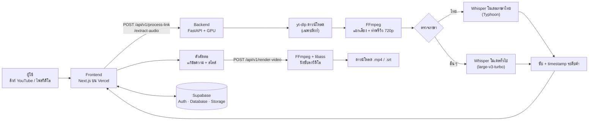

# ZaiZub 🎬

**ซับไตเติลอัตโนมัติสำหรับคลิปสั้น** — แปะลิงก์ YouTube หรืออัปโหลดวิดีโอ แล้ว AI จะถอดเสียงเป็นซับให้ พร้อมให้แก้ไข ตกแต่ง และเรนเดอร์ซับลงบนวิดีโอได้ในเว็บเดียว

🌐 **ลองใช้งาน:** https://zaizub.vercel.app/

---

## ทำอะไรได้บ้าง

| | ฟีเจอร์ |
|---|---|
| 🎙️ | **ถอดเสียงอัตโนมัติ ภาษาไทยและอังกฤษ** ตรวจภาษาของคลิปให้เอง (ภาษาอื่น ๆ ก็ถอดได้ผ่านโมเดลทั่วไป) |
| 🔗 | **รับได้ 2 แบบ** วางลิงก์ YouTube หรืออัปโหลดไฟล์วิดีโอ |
| ⏱️ | **ซับตรงจังหวะคำพูด** มี timestamp ระดับคำ ตัดบรรทัดตามคำภาษาไทยจริง ไม่ตัดกลางคำ |
| ✏️ | **ตัวตัดต่อซับ** แก้ข้อความ เพิ่ม/ลบแคปชัน ค้นหาคำ ปรับจำนวนคำต่อการ์ด พรีวิวพร้อมวิดีโอ |
| 🎨 | **ตกแต่งสไตล์** ฟอนต์ไทย/อังกฤษกว่า 17 แบบ ขนาด สี ตัวหนา/เอียง/ขีดเส้นใต้ เงา ขอบ พื้นหลัง ลากวางตำแหน่ง แอนิเมชัน (Fade, Pop, Typewriter) และเทมเพลตสำเร็จรูป |
| 📐 | **3 สัดส่วนจอ** 9:16 (TikTok/Reels/Shorts), 16:9, 1:1 |
| 💾 | **บันทึกโปรเจกต์** ไว้ใน My Video กลับมาแก้ต่อได้ (ต้องล็อกอิน) |
| 📤 | **ส่งออก** ไฟล์ซับ `.srt` หรือเรนเดอร์วิดีโอ `.mp4` ที่ฝังซับแล้ว ตั้งชื่อไฟล์ตามชื่อโปรเจกต์ |

> ตัวตัดต่อ, My Video และโปรไฟล์ต้องล็อกอินก่อน (อีเมล/รหัสผ่าน หรือ Google) ส่วนหน้าแรกกดสร้างซับได้เลย

---

## ทำงานยังไง



**ขั้นตอนทีละสเต็ป**

1. **ส่งวิดีโอเข้าระบบ** — หน้าแรกส่งลิงก์หรือไฟล์ไปที่ backend (ลิงก์จะถูกดาวน์โหลดด้วย yt-dlp)
2. **เตรียมไฟล์** — FFmpeg แยกเสียงเป็น 16 kHz mono พร้อมทำวิดีโอพรีวิว 720p และภาพปก (ทำขนานกับการถอดเสียง) ไฟล์พรีวิวถูกอัปโหลดขึ้น Supabase Storage
3. **ตรวจภาษาแล้วถอดเสียง** — ภาษาไทยใช้โมเดลที่ fine-tune สำหรับภาษาไทย ภาษาอื่นใช้โมเดลทั่วไป ผลลัพธ์เป็นซับพร้อมเวลาระดับคำ
4. **แก้และตกแต่ง** — ผู้ใช้เข้าตัวตัดต่อ ปรับข้อความ สไตล์ ตำแหน่ง สัดส่วนจอ แล้วบันทึกลง Supabase
5. **เรนเดอร์** — FFmpeg + libass ฝังซับลงวิดีโอด้วยฟอนต์ชุดเดียวกับที่เห็นในพรีวิว ถ้าไฟล์ต้นฉบับยังอยู่บนเซิร์ฟเวอร์ (เก็บไว้ 6 ชั่วโมง) จะเรนเดอร์จากต้นฉบับที่คุณภาพเต็ม ถ้าหมดอายุแล้วจะใช้พรีวิว 720p จากคลาวด์แทน

---

## เทคโนโลยีที่ใช้

| ส่วน | เทคโนโลยี |
|---|---|
| Frontend | Next.js 16, React 19, TypeScript, Tailwind CSS 4 |
| Auth / DB / Storage | [Supabase](https://supabase.com) (อีเมล + Google OAuth, Postgres + RLS, Storage bucket `videos`) |
| Backend | Python, FastAPI, Uvicorn |
| ถอดเสียง | [faster-whisper](https://github.com/SYSTRAN/faster-whisper) บน [CTranslate2](https://github.com/OpenNMT/CTranslate2) |
| โมเดลภาษาไทย | [typhoon-ai/typhoon-whisper-turbo](https://huggingface.co/typhoon-ai/typhoon-whisper-turbo) (ค่าเริ่มต้นของ repo คือ [Biodatlab](https://huggingface.co/Vinxscribe/biodatlab-whisper-th-large-v3-faster) ดาวน์โหลดอัตโนมัติ) |
| โมเดลภาษาอื่น | [large-v3-turbo](https://huggingface.co/mobiuslabsgmbh/faster-whisper-large-v3-turbo) |
| ตัดคำไทย | [PyThaiNLP](https://github.com/PyThaiNLP/pythainlp) |
| ดาวน์โหลดคลิป | [yt-dlp](https://github.com/yt-dlp/yt-dlp) |
| วิดีโอ | [FFmpeg](https://ffmpeg.org) + [libass](https://github.com/libass/libass) |
| ฟอนต์ | [Google Fonts](https://github.com/google/fonts) (SIL OFL) แนบมากับ repo ใน `backend/fonts/` |

Frontend อยู่บน Vercel ส่วน Backend โฮสต์เองบนเซิร์ฟเวอร์ที่มี GPU NVIDIA

---

## ความแม่นยำที่วัดได้

วัดบนข้อมูลทดสอบสั้นและเสียงสะอาด ตัวเลขบนคลิปจริงที่มีเสียงรบกวนจะแย่กว่านี้ แต่ลำดับดี-แย่ของโมเดลน่าจะเหมือนเดิม

| งาน | ผล |
|---|---|
| ภาษาไทย 200 คลิป (Typhoon turbo) | CER ≈ **1.9%** (Biodatlab ≈ 2.9%) |
| ภาษาอังกฤษ 40 คลิป (LibriSpeech) | WER ≈ **5%** |
| ตรวจภาษาถูก (เสียง ≥ 15 วินาที) | ถูกทั้งหมดในชุดทดสอบ ส่วนประโยคสั้น 2–5 วินาทีอาจพลาด |

---

## โครงสร้างโปรเจกต์

```
.
├── frontend/              # เว็บ Next.js (หน้าแรก, ล็อกอิน, ตัวตัดต่อ, My Video, โปรไฟล์)
│   ├── app/               # routes และ server actions
│   ├── components/        # editor/, landing/, video/, account/ ...
│   ├── lib/               # supabase client, api helper
│   └── supabase/migrations/   # SQL สร้างตารางและนโยบาย RLS
└── backend/               # FastAPI: ถอดเสียง, ดาวน์โหลดคลิป, เรนเดอร์
    ├── app/               # api/, services/ (ถอดเสียง), utils/ (สร้างไฟล์ .ass), core/
    ├── fonts/             # ฟอนต์สำหรับฝังซับ
    └── README.md          # 👈 วิธีรัน backend บนเครื่องตัวเอง
```

---

## รันบนเครื่องตัวเอง

อ่านวิธีติดตั้งและรัน backend ที่ **[backend/README.md](backend/README.md)** (รวมวิธีต่อกับ frontend ด้วย)

ส่วน frontend โดยย่อ:

```bash
cd frontend
npm install
npm run dev        # เปิดที่ http://localhost:3000
```

ต้องสร้างไฟล์ `frontend/.env.local` และตั้งค่า Supabase ของตัวเอง รายละเอียดอยู่ใน backend/README.md หัวข้อ "ต่อกับ Frontend"

---

## ข้อจำกัดที่ควรรู้

- ลิงก์ YouTube บางครั้งโดนบล็อกจาก IP ของเซิร์ฟเวอร์ ทำให้ดาวน์โหลดไม่ได้หรือได้ภาพความละเอียดต่ำ ระบบมีทางสำรองให้แล้ว แต่ YouTube เปลี่ยนกติกาบ่อย
- ฟอนต์ที่ผู้ใช้อัปโหลดเองในตัวตัดต่อมีผลเฉพาะพรีวิวในเบราว์เซอร์ ตอนเรนเดอร์จะใช้เฉพาะฟอนต์ที่แนบมากับระบบ
- วิดีโอที่ภาษาปนกันจะถูกถอดเป็นภาษาหลักภาษาเดียว (ภาษาไทยที่มีคำอังกฤษแทรกยังใช้ได้ดี)
- ถอดเสียงได้ทีละคลิป คลิปอื่นจะรอคิว

---

## เครดิต

ขอบคุณโปรเจกต์โอเพนซอร์สที่ใช้ในระบบนี้: faster-whisper, CTranslate2, Typhoon (SCB 10X), Biodatlab, PyThaiNLP, yt-dlp, FFmpeg, libass, Supabase, Next.js และ Google Fonts
